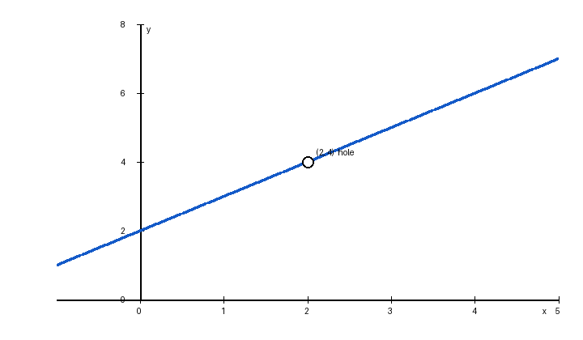

---
tags:
  - 诊断卷
created: 2026-10-20
---

# 高等数学 第一章 诊断卷（示例）

> 覆盖 §1.1–1.8 中的五个小节｜满分 30 分｜示例卷，非正式考试

> <b>说明</b>：这是 exam-paper-maker 的 schema v2 示例，展示题目元数据、分数校验、数值复核、公式、插图与诊断表。

---

## 一、单项选择题（每小题 3 分，共 12 分）

1. 下列各组函数中表示同一函数的是（　　）
   A. f(x) = x，g(x) = (√x)2
   B. f(x) = |x|，g(x) = √(x2)
   C. f(x) = ln x2，g(x) = 2ln x
   D. f(x) = x，g(x) = ln(ex)

2. 当 x→0 时，与 x 等价的无穷小是（　　）
   A. sin x　　　B. 1 - cos x　　　C. x·sin x　　　D. √(1 + x) - 1

3. 函数 f(x) = (x2 - 1)/(x - 1) 在 x = 1 处的间断点类型是（　　）
   A. 可去间断点　　　B. 跳跃间断点　　　C. 无穷间断点　　　D. 振荡间断点

4. 计算 lim(x→1) (x3 - 1)/(x2 - 1)，结果为（　　）
   A. 1　　　B. 3/2　　　C. 2　　　D. 不存在

## 二、计算题（每小题 6 分，共 12 分）

1. 计算下列极限，并说明该函数在 x = 2 处的性态。
   lim(x→2) (x<super>2</super> - 4)/(x - 2) = ?
   

2. 计算 lim(x→∞) ((x + 1)/(x - 1))x。

## 三、证明题（6 分）

用 ε-N 定义证明：lim(n→∞) (2n + 1)/(n + 1) = 2。

---

# 答案与评分标准

## 一、单项选择题（每小题 3 分，共 12 分）

<b>A1.</b> D　ln(ex) = x 对一切实数成立；A、B、C 的定义域或对应法则不同。　给分点：概念判断（3 分）
<b>A2.</b> A　sin x ~ x；1 - cos x 是二阶；x·sin x 是二阶；√(1 + x) - 1 ~ x/2。　给分点：等价无穷小（3 分）
<b>A3.</b> A　x ≠ 1 时 f(x) = x + 1 → 2，而在 x = 1 无定义，为可去间断点。　给分点：间断点分类（3 分）
<b>A4.</b> B　因式分解：(x - 1)(x2 + x + 1)/[(x - 1)(x + 1)] = (x2 + x + 1)/(x + 1) → 3/2。　给分点：因式分解与极限（3 分）

## 二、计算题（每小题 6 分，共 12 分）

<b>B1.</b> 4；在 x = 2 处无定义，但极限存在，为可去间断点。　x ≠ 2 时 (x2 - 4)/(x - 2) = x + 2 → 4。　给分点：因式分解或代入化简（3 分）；求极限值（2 分）；指出可去间断点（1 分）
<b>B2.</b> e2　底数写成 1 + 2/(x - 1)，指数 x 乘无穷小 2/(x - 1) 趋于 2，故极限为 e2。　给分点：凑重要极限形式（4 分）；指数处理与结果（2 分）

## 三、证明题（6 分）

<b>C1.</b> 提示：|(2n + 1)/(n + 1) - 2| = 1/(n + 1) < ε，取 N 为 1/ε 向上取整。　完整写法见答案：任给 ε > 0 → 作差化简 → 反解 → 取 N → 结论句。　给分点：任给 ε > 0（1 分）；作差并化简（2 分）；反解并取 N（2 分）；结论句（1 分）　证明自查：前提逐条核对：极限过程是 n→∞，ε > 0 任意给定，N 必须是正整数；作差后化简到只含 n 的表达式；反解出 n 的不等式并取 N；结论句写全：当 n > N 时恒有 |·| < ε

## 双向细目表（含逐题考点定位）

| 题号 | 考点 | 难度 | 分值 |
| --- | --- | --- | ---: |
| A1 | §1.1 | 基础 | 3 |
| A2 | §1.7 | 基础 | 3 |
| A3 | §1.8 | 基础 | 3 |
| A4 | §1.5 | 基础 | 3 |
| B1 | §1.5 | 中等 | 6 |
| B2 | §1.6 | 中等 | 6 |
| C1 | §1.6 | 挑战 | 6 |

## 分小节得分表（自填）

| 小节 | 题号 | 满分 | 我的得分 | 得分率 |
| --- | --- | ---: | --- | --- |
| §1.1 | A1 | 3 |  |  |
| §1.5 | A4、B1 | 9 |  |  |
| §1.6 | B2、C1 | 12 |  |  |
| §1.7 | A2 | 3 |  |  |
| §1.8 | A3 | 3 |  |  |

## 诊断对照表

| 分数 | 层级 | 说明 |
| --- | --- | --- |
| 27-30 | 第 5 层 | 概念、计算与证明都稳 |
| 21-26 | 第 4 层 | 个别技巧需要补 |
| 15-20 | 第 3 层 | 会算；证明与概念题需加强 |
| 0-14 | 第 2 层 | 回补定义与基本性质 |

> 注意：分档是启发式参考，不是标准化测量；真正的诊断需要题目难度与区分度数据。

## 命题依据与核验记录

| 用途 | 来源 | 链接 | 访问日期 |
| --- | --- | --- | --- |
| C1 命题依据 | Limit of a sequence - Wikipedia | https://en.wikipedia.org/wiki/Limit_of_a_sequence | 2026-10-20 |
| C1 命题依据 | 2.5: The Precise Definition of a Limit - LibreTexts | https://math.libretexts.org/Bookshelves/Calculus/Calculus_(OpenStax)/02%3A_Limits/2.05%3A_The_Precise_Definition_of_a_Limit | 2026-10-20 |
